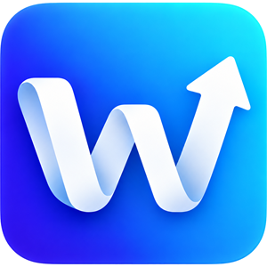
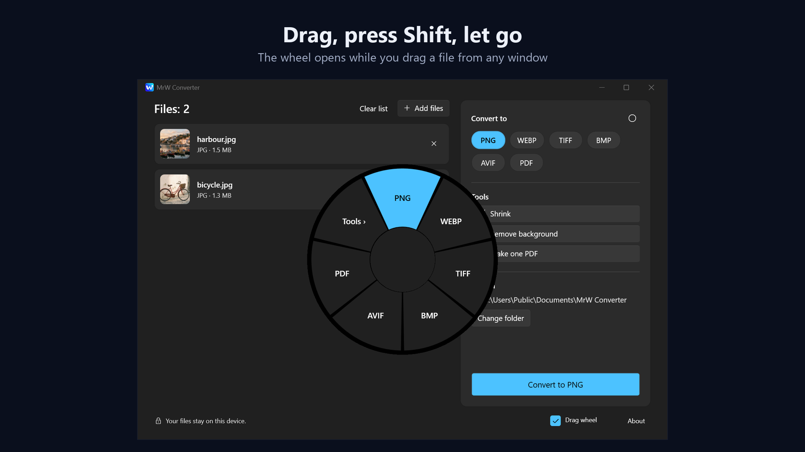
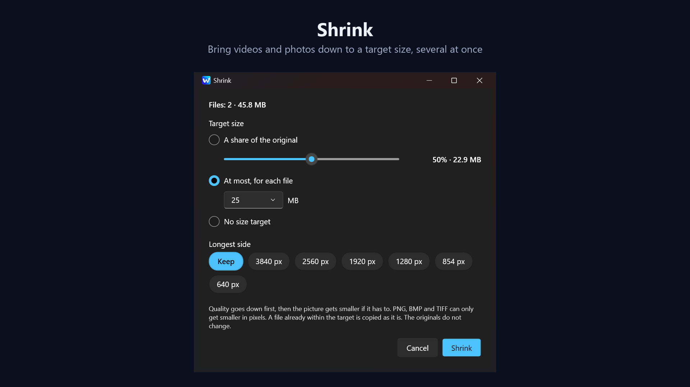
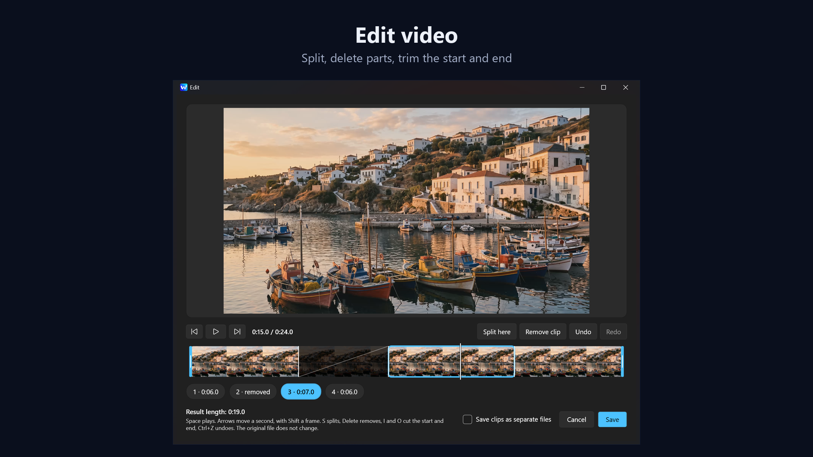

<p align="center"></p>

<h1 align="center">MrW Converter</h1>

<p align="center">Convert files by dragging them. Drag a file from any window, press Shift, and let go on the slice you want.</p>

<p align="center"><a href="https://converter.mrwproject.com/">Website</a> · <a href="README.tr.md">Türkçe</a></p>



A Windows app that converts, shrinks and edits pictures, sound, video and PDFs. Everything runs on your own computer: no account, no ads, no usage data, and your files are never uploaded.

Coming soon to the Microsoft Store.

## What it does

- **Drag wheel:** press Shift while dragging a file from any window, then let go on a format or a tool. It works while the app waits in the system tray, and your normal drags stay as they are.
- **Convert:**
  - Images: JPG, PNG, WebP, TIFF, BMP, AVIF, PDF
  - Audio: MP3, M4A, WAV, FLAC, OGG, Opus; also reads AIFF and WMA
  - Video: MP4, MOV, MKV, WebM, GIF; also reads AVI and WMV
  - PDF to Word, PNG, JPG and text
  - Word, Excel, PowerPoint and more to PDF, with LibreOffice, which the app downloads only if you agree
- **Shrink:** bring videos and photos down to a target size, several files at once.
- **Remove background:** a transparent PNG from an AI model that runs inside the app.
- **PDF tools:** combine PDFs, pictures and Office files into one PDF, or split a PDF into pages.
- **Edit video and audio:** split, delete parts, trim the start and end. For video, also crop an area, remove the sound and save a frame.
- **Crop and censor pictures:** cover what you mark with black, noise or mosaic.





## Layout

| Folder | What is there |
| --- | --- |
| `src/MrWConverter.Core` | The engine, with no interface: format catalog, safe output, converters and tools |
| `src/MrWConverter.App` | The WPF interface (.NET 10) |
| `tests/MrWConverter.Core.Tests` | xUnit tests |
| `packaging` | MSIX manifest, Store images and logo |
| `scripts` | Downloads, builds and packaging |

## Build from source

You need Windows 10 or 11 and the .NET 10 SDK. The MSIX also needs the Windows SDK.

The FFmpeg that ships with the app is built from pinned sources, with only the parts the app uses. Nothing is installed on your machine, and it takes about 2 GB of disk:

```bash
powershell -ExecutionPolicy Bypass -File scripts/build-ffmpeg.ps1
```

The tests make their sample files with the full FFmpeg, and the background removal model is a separate download. Without these, the tests that need them show as skipped:

```bash
powershell -ExecutionPolicy Bypass -File scripts/setup-ffmpeg.ps1
```

```bash
powershell -ExecutionPolicy Bypass -File scripts/setup-models.ps1
```

Build, test and run:

```bash
dotnet build MrWConverter.slnx
```

```bash
dotnet test tests/MrWConverter.Core.Tests
```

```bash
dotnet run --project src/MrWConverter.App
```

Make an MSIX:

```bash
powershell -ExecutionPolicy Bypass -File scripts/package.ps1
```

## License

The app's own code is under the [MIT License](LICENSE). Its components come with their own licenses, listed in [THIRD-PARTY-NOTICES.txt](src/MrWConverter.App/THIRD-PARTY-NOTICES.txt) and in the app's About window. FFmpeg is used under the LGPL 2.1, and the source of the exact build is at <https://converter.mrwproject.com/open-source/>.
