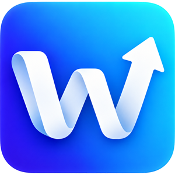
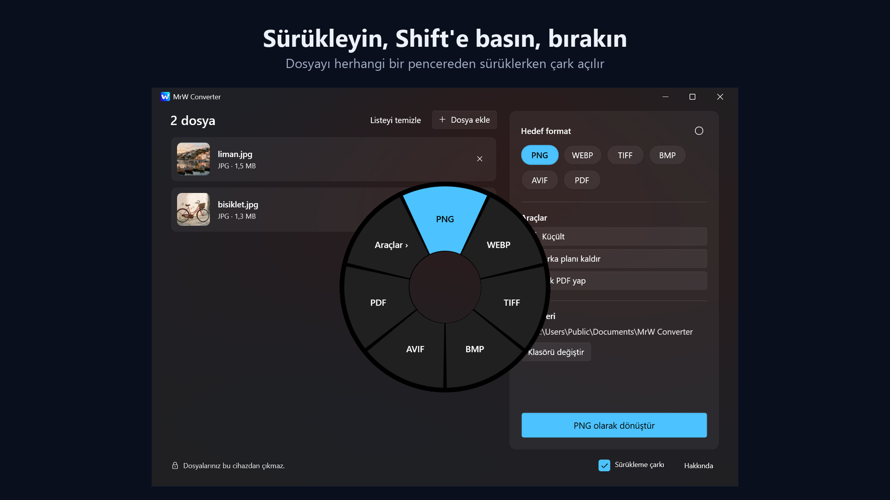
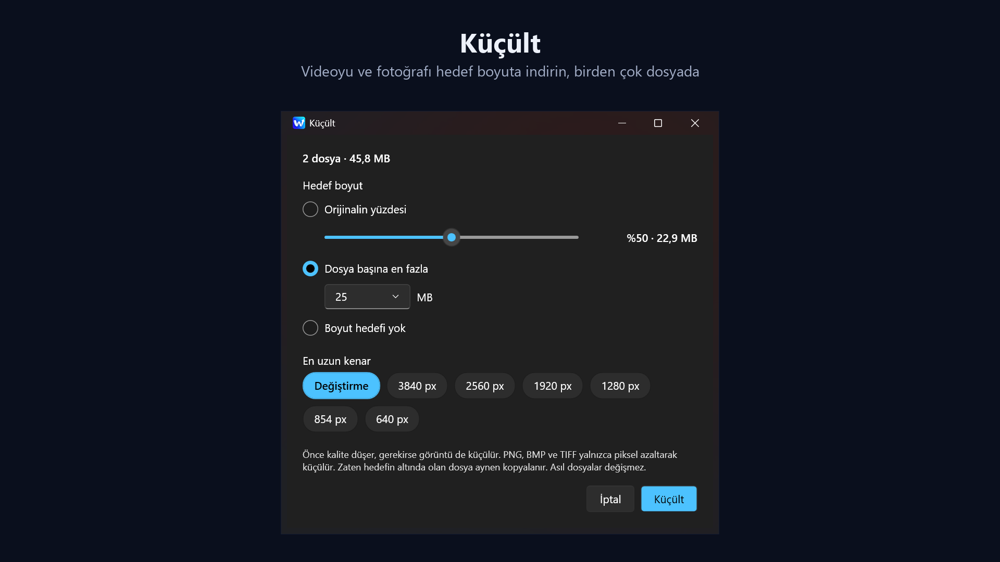
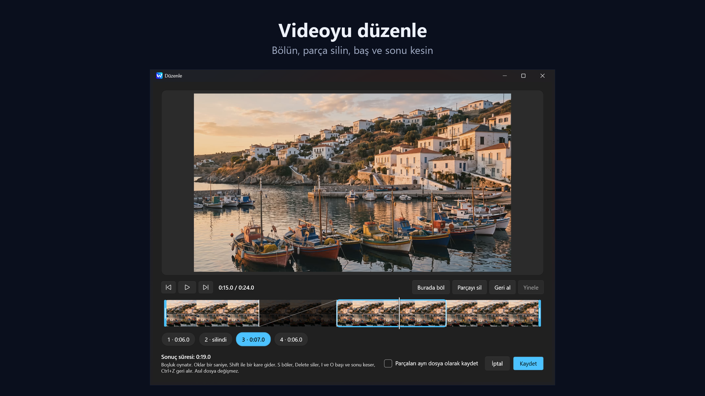

<p align="center"></p>

<h1 align="center">MrW Converter</h1>

<p align="center">Dosyaları sürükleyerek dönüştürün. Bir dosyayı herhangi bir pencereden sürüklerken Shift'e basın, istediğiniz dilimin üstünde bırakın.</p>

<p align="center"><a href="https://converter.mrwproject.com/tr/">Web sitesi</a> · <a href="README.md">English</a></p>



Görsel, ses, video ve PDF dosyalarını dönüştüren, küçülten ve düzenleyen bir Windows uygulaması. Her şey kendi bilgisayarınızda çalışır: hesap, reklam ve kullanım verisi yoktur, dosyalarınız hiçbir yere yüklenmez.

<p align="center"><a href="https://apps.microsoft.com/detail/9mtckzxrffxg"></a></p>

## Neler yapar

- **Sürükleme çarkı:** Bir dosyayı herhangi bir pencereden sürüklerken Shift'e basın, bir format veya aracın üstünde bırakın. Uygulama sistem tepsisinde beklerken de çalışır, normal sürüklemelerinize karışmaz.
- **Dönüştürme:**
  - Görsel: JPG, PNG, WebP, TIFF, BMP, AVIF, PDF
  - Ses: MP3, M4A, WAV, FLAC, OGG, Opus; ayrıca AIFF ve WMA okur
  - Video: MP4, MOV, MKV, WebM, GIF; ayrıca AVI ve WMV okur
  - PDF'ten Word, PNG, JPG ve metne
  - Word, Excel, PowerPoint ve daha fazlasından PDF'e; bunun için gereken LibreOffice yalnızca onay verirseniz indirilir
- **Küçült:** Videoyu ve fotoğrafı hedef boyuta indirin, birden çok dosyada da çalışır.
- **Arka planı kaldır:** Uygulamanın içinde çalışan bir yapay zekâ modeliyle saydam PNG.
- **PDF araçları:** PDF'leri, görselleri ve Office dosyalarını tek PDF yapın, PDF'i sayfalarına ayırın.
- **Video ve ses düzenleme:** Bölün, parça silin, baş ve sonu kesin. Videoda alan kırpma, sesi kaldırma ve kare alma da vardır.
- **Görsel kırpma ve sansür:** İşaretlediğiniz yeri siyah, gürültü veya mozaikle kapatın.





## Yapı

| Klasör | İçerik |
| --- | --- |
| `src/MrWConverter.Core` | Arayüzden bağımsız motor: format kataloğu, güvenli çıktı, dönüştürücüler ve araçlar |
| `src/MrWConverter.App` | WPF arayüzü (.NET 10) |
| `tests/MrWConverter.Core.Tests` | xUnit testleri |
| `packaging` | MSIX bildirimi, Store görselleri ve logo |
| `scripts` | İndirme, derleme ve paketleme |

## Kaynaktan derleme

Windows 10 veya 11 ve .NET 10 SDK gerekir. MSIX için ayrıca Windows SDK gerekir.

Uygulamayla gelen FFmpeg, sürümleri sabit kaynaklardan, yalnızca uygulamanın kullandığı parçalarla derlenir. Makineye bir şey kurulmaz, yaklaşık 2 GB yer kaplar:

```bash
powershell -ExecutionPolicy Bypass -File scripts/build-ffmpeg.ps1
```

Testler örnek dosyalarını tam FFmpeg ile üretir, arka plan modeli de ayrı iner. Bunlar olmadan ilgili testler "atlandı" görünür:

```bash
powershell -ExecutionPolicy Bypass -File scripts/setup-ffmpeg.ps1
```

```bash
powershell -ExecutionPolicy Bypass -File scripts/setup-models.ps1
```

Derleme, test ve çalıştırma:

```bash
dotnet build MrWConverter.slnx
```

```bash
dotnet test tests/MrWConverter.Core.Tests
```

```bash
dotnet run --project src/MrWConverter.App
```

MSIX üretme:

```bash
powershell -ExecutionPolicy Bypass -File scripts/package.ps1
```

## Lisans

Uygulamanın kendi kodu [MIT Lisansı](LICENSE) ile sunulur. Bileşenler kendi lisanslarıyla gelir; [THIRD-PARTY-NOTICES.txt](src/MrWConverter.App/THIRD-PARTY-NOTICES.txt) dosyasında ve uygulamanın Hakkında penceresinde listelenir. FFmpeg, LGPL 2.1 ile kullanılır; tam derlemenin kaynağı <https://converter.mrwproject.com/tr/open-source/> adresindedir.
